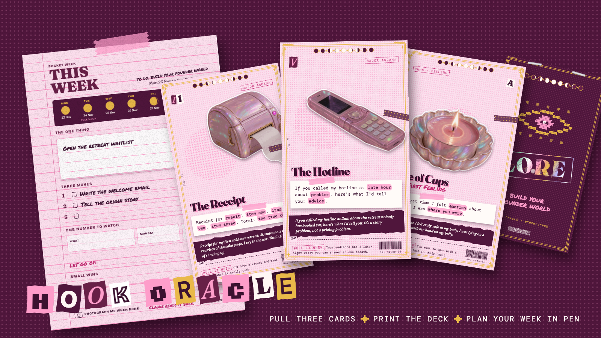
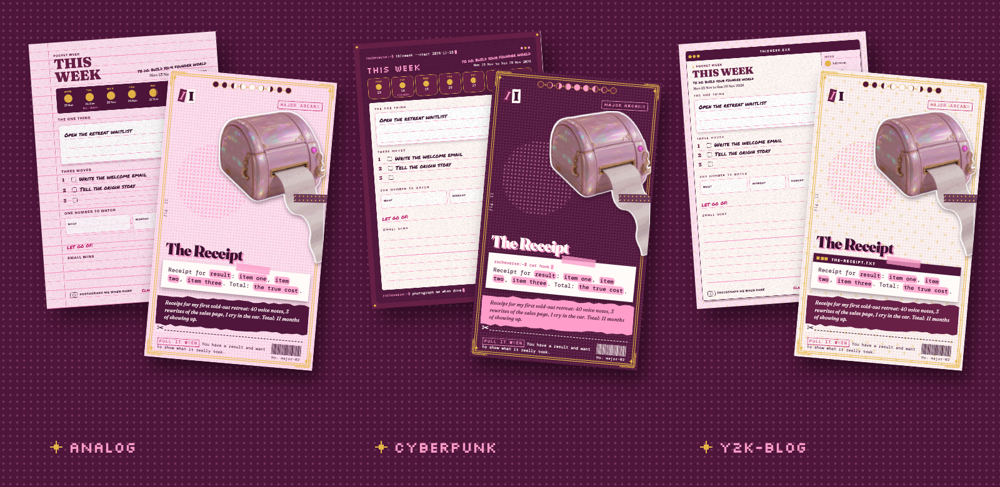
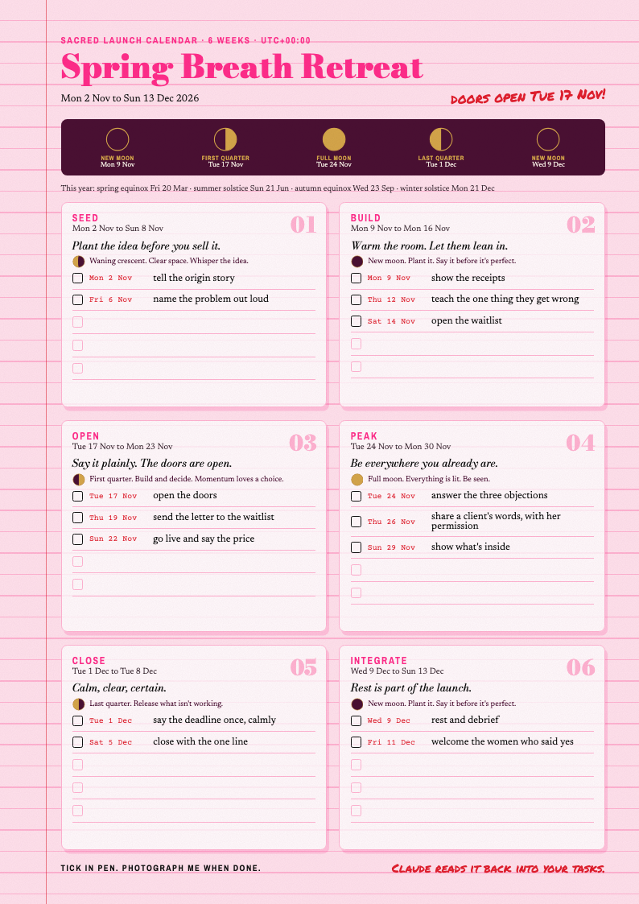
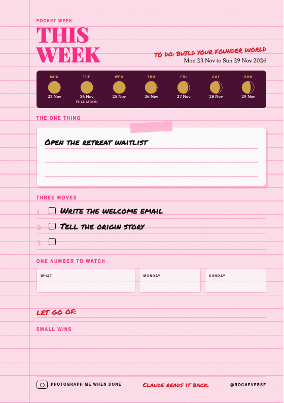

# Analog Bag

*Rocha Coded. Free tools from the Rocheverse.*

**A printable founder kit for your bag.**

Plan offline, in pen.
Pull three cards for your next post, on paper or on screen.
Lay your launch on the real moon.
Photograph the page when you're done, and Claude reads it back into your tasks.

<p align="center"></p>

<p align="center"></p>

<p align="center"><sub>One week, three looks: analog, cyberpunk and y2k-blog. Pick the look, then make the colours and fonts yours. Every example is written for Wren, a made-up breathwork teacher, and her numbers are invented to show the shape.</sub></p>

<p align="center"></p>


## Start here
Five steps, about ten minutes, once. You'll type a few lines into the terminal: the app on your computer where you give it instructions in words. Copy each line exactly, press Enter, and check you see what the step says.

 **Open the terminal.** On a Mac, press Command and Space, type `Terminal`, press Enter. A small window opens with a blinking cursor. That's it, you're in.

 **Check Python is there.** Python is the free language the kit is written in. This line asks for its version:
```sh
python3 --version
```
You'll see `Python 3.10` or a higher number. If you see something else, the first fix in [If it goes wrong](#if-it-goes-wrong-everyones-first-time) has you covered.

 **Copy the kit onto your computer.** To clone means to download a copy that can update itself later. This puts it where Claude Code looks for skills (a skill is a folder of instructions Claude can follow):
```sh
git clone https://github.com/RochaStone/analog-bag ~/.claude/skills/analog-bag
```
You'll see `Cloning into...` and then your cursor again.

 **Pull your first three cards.** This checks everything works:
```sh
python3 ~/.claude/skills/analog-bag/tarot/pull.py --topic "my next post" --audience "my people"
```
You'll see `HOOK ORACLE three-card pull` and three cards with their hook shapes.

 **Make your first page.** Open Claude Code in the folder where you want your pages kept (Claude Code is Claude working right inside your terminal). Then say: "Make my pocket week." You'll see `week.pdf` appear in that folder, ready to print.

Using the Claude desktop app instead? Go to [Claude Cowork](#claude-cowork): you'll upload one zip (a single compressed file holding the whole kit) and then ask for your first page.

<p align="center"></p>

## What you get
- **HOOK ORACLE.** 78 hook structures as a real deck. Print it, cut it, keep it in your bag. 22 Major Arcana for the big ideas (The Receipt, The One Woman Show, The Guest Check, Too Busy, The Hotline, The Front Page). Cups for story and feeling. Wands for bold and contrarian. Swords for questions and challenges. Pentacles for numbers, proof and results.
- **A three-card pull.** What they believe, what you'll say, what they'll do. Claude fills every blank with your topic, in your words.
- **The oracle on screen.** Open `oracle.html` in your browser and pull on screen: shuffle, turn the cards, fill the pink blanks, copy the hook, save the spread as a story.
- **Monthly sets.** A small new set of hook shapes each month, on top of the core 78.
- **Sacred Launch Calendar.** Your launch in six stages: seed, build, open, peak, close, integrate. Each stage starts on a real moon phase, with two or three plain-language beats. One printable page, plus a calendar file for your phone.
- **Pocket Week.** One A5 page. THIS WEEK. The one thing. Three moves. One number to watch. What you're letting go of. The moon for each day.
- **The readback.** Snap a photo of any filled page. Claude reads your handwriting, ticks what's done and merges it into one running `tasks.md`. Nothing ever gets added twice, and nothing you finished gets unticked.

The moon is computed on your computer from the astronomy itself. No app, no account, no internet. It matches NASA's 2026 tables to the minute.

<p align="center"></p>

## Install
It runs inside Claude. Nothing to host, no account to make, and your pages stay on your computer.

| Where you use it | Install it | Start it |
|---|---|---|
| [Claude Code](#claude-code) (recommended) | clone into `~/.claude/skills` | ask "pull three cards" or "make my pocket week" |
| [Claude Cowork](#claude-cowork) | upload `analog-bag.zip` as a skill | ask for a launch calendar in a Cowork task |

You need Python 3.10 or newer ([Start here](#start-here) shows how to check). For PDFs you also need Google Chrome, Chromium or Microsoft Edge installed.
Without one you still get every page as a web page: open it, choose Print, then Save as PDF.

### Claude Code
```sh
git clone https://github.com/RochaStone/analog-bag ~/.claude/skills/analog-bag
```
Open Claude Code in a folder where you want your pages saved, and ask: "Pull three cards for my spring retreat."
To update later: `git -C ~/.claude/skills/analog-bag pull`.

### Claude Cowork
Cowork (the Claude desktop app) runs tasks in a sandbox: a safe, closed-off space on your computer that can only reach the folders you give it.
1. Download `analog-bag.zip` from the [latest release](https://github.com/RochaStone/analog-bag/releases/latest).
2. In the Claude desktop app: Customize > Skills, then + > Create skill > Upload a skill, and pick the zip.
3. In Settings > Capabilities, turn on code execution and file creation.
4. Make a folder for your pages, for example `analog-bag` in your home folder. Start a Cowork task, give it
   access to that folder, and ask: "Make me a sacred launch calendar for my retreat, starting 2 November."
5. Your pages, the calendar file and `tasks.md` land in that folder.

The sandbox may not have Chrome. If it doesn't, you get the pages as web pages. Open them in your own browser
and print from there. Tell Claude your city so the moon lands on your local date.

<p align="center"></p>

## How to use it
**Pull three cards.** "Pull three cards for my retreat, for burnt-out founders." You get three hook shapes, filled in for you.

**Pull on screen.** Open `oracle.html` (double-click it in the kit's folder) to pull on screen. Type what it's about and who it's for, pick a spread (one card, two, three, or the full spread), press Pull the cards and tap each card to turn it. The pink blanks fill with your words as you type, and you can edit any of them. Copy hook puts one line on your clipboard. Save spread downloads a 1080 x 1920 picture for your stories. Everything stays on your computer: no account, nothing sent anywhere. Keep `oracle.html` next to the `tarot` folder so the card pictures load. To bake your own look in, run `python3 tarot/oracle.py --style style.json`, or press "use my style.json" on the page.

**Print the deck.** "Print the hook oracle." Card stock, actual size, cut on the marks. Tarot size is 70 x 120 mm, four to a page. Want nine to a page? Ask for the mini size (63 x 88 mm). For backs, print double-sided and flip on the long edge.

**Plan a launch.** "Make a moon launch calendar for my Spring Breath Retreat, starting 2 November, six weeks." Print the page, import `launch.ics` into your calendar, tick the beats in pen.

**Plan the week.** "Make my pocket week." Print it on A5, or ask for two-up to get two copies on one A4 sheet.

**Pick a look.** The launch page and the pocket week come in three looks: analog (pink lined paper), cyberpunk (a plum console) and y2k-blog (a 2003 blog window). Say "make it cyberpunk", or set it once in your style file. The tarot stays plum and gold in every look.

**Read it back.** Sunday night, take a photo of the page and drop it in: "Read my page." Claude tells you what's done, what's new and what's still open.

Prefer the terminal? Every piece runs on its own:
```sh
python3 tarot/pull.py --topic "my spring retreat" --audience "burnt-out founders"
python3 tarot/print.py --out out/
python3 tarot/print.py --out out/ --set samhain-2026
python3 tarot/oracle.py
python3 launch/launch.py --offer "Spring Breath Retreat" --date 2026-11-02 --weeks 6 --out out/ --utc-offset +08:00
python3 week/week.py --out out/ --motif y2k-blog
python3 readback/merge.py tasks.md new.md
```

<p align="center"> </p>

<p align="center"></p>

## Monthly sets
A new set of hook shapes comes out each month as a release, with a theme for the season. Each set is one file in `tarot/sets/`, and the core 78 in `tarot/sets/core.json` are always in the deck.
The paid coven gets each set a week early.

- **On screen.** Every set shows up in the set picker on `oracle.html`. A set released in the last 30 days wears a "new" tag. Turn it on to mix it into your pulls.
- **In Claude.** Ask "pull three cards with the Samhain set", or add `--set samhain-2026` to `tarot/pull.py`.
- **On paper.** `python3 tarot/print.py --out out/ --set samhain-2026` prints that set as its own little deck, with the set name on the front and back of every card.

This month's set is **Samhain 2026**: eight hook shapes for releasing, harvesting and turning toward the dark half of the year.
To update to a new month, run `git -C ~/.claude/skills/analog-bag pull`, or download the new zip.

<p align="center"></p>

## If it goes wrong (everyone's first time)
 These happen to everyone the first time. Each one has a quick fix.

- **"command not found: python3", or a version below 3.10.** Install Python from [python.org/downloads](https://www.python.org/downloads/), close the terminal, open a fresh one and run step 2 again.
- **"command not found: git", or a box asking to install developer tools.** On a Mac, click Install in that box and wait for it to finish, then run step 3 again. Git is the free tool that does the cloning.
- **You got a web page instead of a PDF.** The kit makes PDFs with Google Chrome, and it didn't find one. Open the `.html` file it made, choose Print, then Save as PDF, with margins set to none and background graphics on. Or install Chrome and ask again.

If the moon lands a day off, tell Claude your city. The kit uses your clock to pick the local date.

## Make it yours
Every page reads one `style.json`: your colours, your fonts, your handle, your look (analog, cyberpunk or y2k-blog) and your own words on the to-do line and the card backs. The look is the structure, the colours and fonts are the finish, and both are yours to curate.
Two come bundled: [Rocha's look](examples/style.rocha-coded.json) as the finished example, and a [blank one](style.example.json) to fill in. Or ask Claude to make yours from a few screenshots you love. The keys are in [STYLE.md](STYLE.md).
The same file works across every Rocha Coded tool, so you make it once.

## What's inside
| Path | What it is |
|---|---|
| `SKILL.md` | The instructions Claude follows for all four flows |
| `tarot/sets/` | The cards: `core.json` holds the 78 (name, structure with `{slots}`, example, when to pull), and each monthly set is its own file |
| `tarot/deck.json` | The spreads and their positions in plain words |
| `tarot/pull.py`, `tarot/print.py` | The three-card pull and the printable deck |
| `oracle.html`, `tarot/oracle.py` | The oracle on screen, and the script that builds it with your look |
| `launch/launch.py` | The launch arc, the moon page, the `.md` and the `.ics` |
| `week/week.py` | The Pocket Week page |
| `core/motif.py` | The three looks: analog, cyberpunk and y2k-blog |
| `readback/merge.py` | Validates a read-back page and merges it into `tasks.md` |
| `STYLE.md`, `style.example.json`, `examples/style.rocha-coded.json` | Your look in one file, a blank to fill and Rocha's as the example |
| `core/` | Moon and season maths (Meeus), the calendar file writer, the printable look, the Chrome renderer |
| `examples/` | Sample cards, pages in every look, a calendar file and a before and after `tasks.md` |
| `scripts/make-readme-images.py` | Renders every image in this README from the kit itself (listed in [docs/IMAGES.md](docs/IMAGES.md)) |
| `tests/` | `python3 -m unittest`. See [tests/TESTING.md](tests/TESTING.md) for what is and isn't tested |

<p align="center"></p>

The deck was called Hook Tarot until October 2026.

## Licence
MIT. See [LICENSE](LICENSE). Copyright (c) 2026 Rochelle Livingstone / Thriving Era Studio.

 [Sign my guestbook](https://github.com/RochaStone/analog-bag/issues)

## Made by Rocha

Rocha \
Brand Alchemist & AI Architect \
Author of *Brand Alchemy in the Thriving Era* and *Thriving in Transformational Times* \
Creator of [Conscious Founder Operating System](https://founders.thrivingera.com) \
Founder, [Thriving Era Studio](https://thrivingera.com)

I help female founders build their founder world, and I build what they need next. \
Start with the audit: [thrivingera.com/audit](https://thrivingera.com/audit). \
Or book an exploratory call: [calendly.com/rochelle-thrivingera/exploratory-call](https://calendly.com/rochelle-thrivingera/exploratory-call). It is where we decide if we work together.

[Instagram @rocheverse](https://instagram.com/rocheverse) · [Substack](https://rochastone.substack.com) · [LinkedIn](https://www.linkedin.com/in/rochellelivingstonecosmic) · [More free tools](https://thrivingera.com/free) · [All tools on GitHub](https://github.com/RochaStone)
